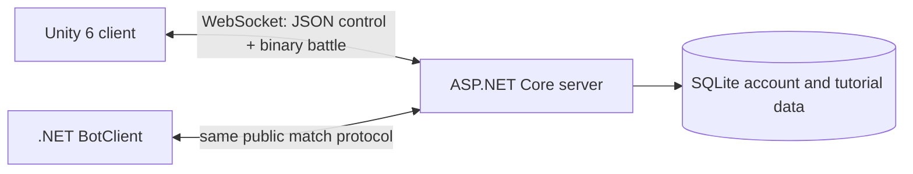
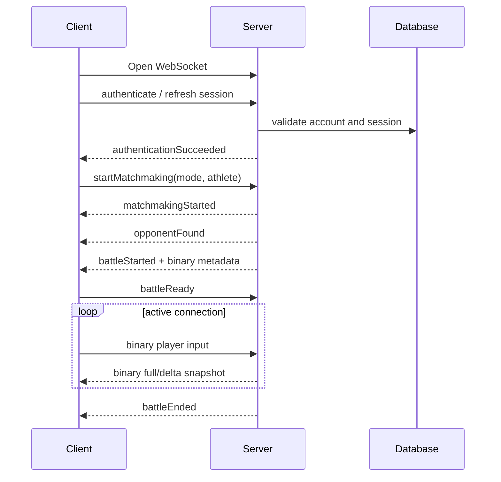

# Mage Duel 2 — Technical Overview

Version: **1.0**

Status: current architecture summary

Updated: 2026-10-12

## 1. System shape

Mage Duel 2 is divided into three executable parts:

| Component | Responsibility |
|---|---|
| Unity client | Input collection, local presentation, UI, animation, VFX, camera and interpolation |
| Game server | Authentication, matchmaking, simulation, rules, timers, projectiles, results and persistence |
| BotClient | Automated participants using ordinary client messages and snapshots |

This separation ensures that bots and human clients operate against the same competitive authority.

## 2. Technology baseline

- **Client:** Unity 6, Universal Render Pipeline, uGUI and TextMeshPro.
- **Server:** ASP.NET Core on .NET 9.
- **Persistence:** Entity Framework Core with SQLite for current development.
- **Bots:** .NET 8 console application.
- **Transport:** a persistent WebSocket connection.
- **Simulation:** 60 ticks per second.
- **Battle state publication:** 30 snapshots per second.

## 3. Authority boundary

The server owns all state that can decide advantage or outcome:

- participant identity and team;
- accepted input sequence;
- player positions and facing;
- energy, maximum-energy penalty and action state;
- cast/attack/roll/block progression;
- projectile creation, motion, rebound, hit and removal;
- round time and phase;
- territory, target zones, referee stages and cards;
- round/match score and terminal result;
- disconnect/reconnect state;
- guided-lesson restrictions and progress.

The Unity client owns presentation decisions that cannot change the result:

- mesh, portrait and animation selection;
- interpolated rendering between snapshots;
- HUD layout and visual effects;
- camera composition;
- scene lighting, water, fire and environment art;
- local input-binding preferences before semantic input is sent.

## 4. Connection and session flow

Authentication is required for the intended product flow. The server supports email/password registration, verification, refresh-token rotation, password reset and logout. Development email delivery is disabled by default and production secrets are external configuration.

## 5. Match lifecycle

The match object contains both player state and shared authoritative state. A fixed-step simulation coordinates specialised systems rather than allowing UI or scene objects to implement rules.

Important simulation responsibilities include:

- input acceptance and timeout;
- movement and encumbrance;
- energy regeneration/penalty;
- cast and attack state machines;
- roll and invulnerability;
- directional block and shield break;
- projectile movement, rope collision and hits;
- territorial resolution and referee positioning;
- round transitions, final duel and match result;
- reconnect break and restart countdown.

Rules are applied under the battle's synchronisation boundary. Presentation events and snapshots are created from the resulting authoritative state.

## 6. Snapshot model

Low-frequency lifecycle messages use JSON. High-frequency input and battle state use binary protocol v3.

The server keeps recipient-specific previous snapshot state and sends:

- a full snapshot for the initial state;
- delta snapshots containing only changed global/player groups and projectile changes;
- a forced full snapshot after a resync request;
- a periodic full snapshot at least every five simulation seconds;
- a full snapshot when the round changes.

Each snapshot acknowledges the latest accepted input sequence, which allows the client to reconcile its presentation with server state.

See [Network Protocol](NetworkProtocol.md) for the wire contract.

## 7. Reconnect

An interrupted active match enters an authoritative reconnect break rather than immediately assigning a loss. The server retains the match for a configured window, publishes connection and countdown state, and can apply automatic defence to the disconnected athlete.

A returning authenticated connection requests the existing battle. After validation, the server binds the new connection, provides current state and runs a restart countdown. Expiry or an unrecoverable disconnect resolves as a forfeit.

## 8. Matchmaking and spectators

The server supports:

- random matchmaking;
- password matchmaking with an eight-character limit;
- cancellation and ready timeout;
- selected athlete identity in match creation;
- a read-only spectator attachment to an active match.

The main-menu broadcast uses the spectator flow and receives the same authoritative snapshots without becoming a battle participant.

## 9. Bots

BotClient is not linked directly into the server simulation. It connects, authenticates/configures identity, enters matchmaking, consumes the public snapshots and sends ordinary input packets.

Behaviour profiles select goals such as direct pressure, rope ricochet and roll-location punishment. Because the server validates every action, a bot cannot bypass energy, timing or territorial rules.

## 10. Guided tutorial

Guided lessons run through the server rather than a client-only scripted scene. The tutorial director assigns a lesson and step, and `TutorialInputPolicy` filters semantic actions. Movement targets, block attempts, roll completion, cast completion and target hits are validated authoritatively.

The Unity TrainingGym scene handles fades, instruction panels, spotlights and the temporary visual environment. This permits the gym art to be replaced without rewriting lesson rules.

## 11. Unity scene flow

Current primary scenes:

| Scene | Responsibility |
|---|---|
| Connection | Account entry and session establishment |
| MainMenu | Arena broadcast, navigation, matchmaking, athlete and settings flows |
| Battle | Player match presentation and complete battle HUD |
| TrainingGym | Guided lessons and Fight the Teacher presentation |

Reusable UI and presentation are stored as prefabs/resources rather than duplicated scene logic. Current asset organisation and validation rules are recorded in [Unity Asset Structure](UnityAssetStructure.md).

## 12. Persistence

Current persistent server data includes account credentials/profile foundation, session/refresh state and tutorial progression. SQLite is suitable for the present local/vertical-slice environment. A production deployment would require a reviewed database strategy, migrations, backups, secrets and operational monitoring.

The Unity client stores refresh material through Windows DPAPI. This is why Windows is the current supported target and macOS should not be claimed until a Keychain implementation and platform QA exist.

## 13. Configuration

Competitive values are supplied through strongly typed server configuration sections:

`Network`, `Authentication`, `Email`, `Matchmaking`, `Energy`, `Block`, `Roll`, `Movement`, `Attack`, `Projectile`, `Cast`, `Battle`, `Arena`, `Tutorial` and `Teacher`.

The checked-in configuration contains safe development defaults, not deployable production secrets. Current gameplay values are mirrored in [Balance and Tuning](BalanceAndTuning.md).

## 14. Verification

Current automated layers include:

- domain and simulation tests for server battle rules;
- authentication, matchmaking, reconnect and tutorial tests;
- binary encoder/traffic tests;
- Unity EditMode and PlayMode tests;
- asset/scene/prefab integrity validators;
- BotClient compilation and runtime smoke paths.

The verified snapshot and remaining gaps are reported in [Project Status](ProjectStatus.md). A headless Unity failure caused by unavailable render textures is classified separately from a proven gameplay or network defect.

## 15. Current production risks

The architecture supports the vertical slice, but a public service additionally needs:

- production database and migration operations;
- configured secrets and email provider;
- rate-limit/proxy/deployment review;
- logs, metrics, alerts and backups;
- CI for server, Unity and bot builds;
- signed distributable builds;
- load, latency and reconnect testing outside a local machine;
- security review of authentication and network exposure.

These are intentionally visible scope items, not hidden behind a “release-ready” label.
