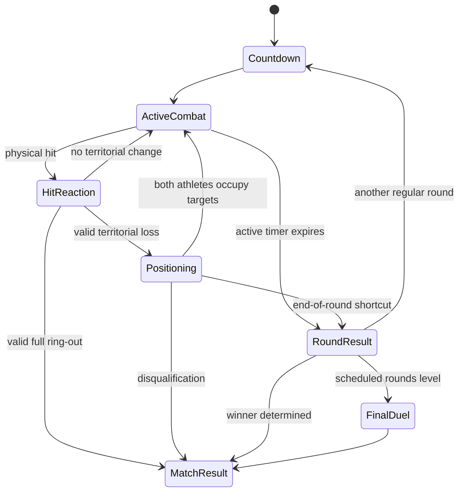

# Mage Duel 2 — Territorial Combat Rules

Version: **1.0**

Status: normative current rules

Updated: 2026-10-12

This document defines the authoritative decisions of a regular Mage Duel 2 match. It supersedes the first-hit round rules and intermediate duels described by the archived GDD v0.1.

## 1. Terms

| Term | Meaning |
|---|---|
| Active combat | Normal round state in which the round timer advances |
| Positioning | Referee state after a territorial change; round timer is frozen |
| Assigned zone | The zone an athlete must occupy before combat resumes |
| Territorial front | The current pair of positions from which the athletes contest space |
| Legal release | Projectile release during active combat |
| Illegal release | Projectile release during positioning |
| Legal hit | Hit caused by a legal release and eligible to change territory |
| Illegal hit | Physical hit caused by an illegal release; never changes territory |
| Full ring-out | Valid displacement beyond the outside edge of the athlete's third zone |
| Yellow card | Persistent match-level penalty; the second card disqualifies the athlete |

## 2. Zone order

```text
Blue outside                                             Red outside
B3 <- B2 <- B1 <- Neutral -> R1 -> R2 -> R3
```

Each zone is currently 20 metres long. “Closer to centre” means the assigned zone has a lower absolute distance from Neutral.

The territorial front resets at the beginning of every regular round. Cards and hit counters persist across the match.

## 3. Regular round lifecycle



The active round timer advances only in `ActiveCombat`. Countdown, hit resolution, referee positioning and server pauses do not consume ordinary combat time.

## 4. Valid hit resolution

When an active-combat projectile hits an opponent, the server resolves the following in order:

1. mark the hit and increment the victim's match hit counter;
2. destroy all projectiles currently held by the victim;
3. retain any projectiles still held by the attacker;
4. start the ordinary hit reaction and temporarily remove victim control;
5. apply knockback in the victim's outward direction;
6. advance the territorial front one step away from centre;
7. determine whether the new result is a normal zone loss or a full ring-out;
8. wait for the visible reaction/flight to complete;
9. either start positioning or end the match.

The baseline knockback distance is one zone width. A second hit that occurs before the first reaction is fully resolved remains a real physical event. Its valid territorial consequences are resolved by the authoritative event ordering, allowing a rare high-skill double connection to push farther without producing two contradictory fronts.

## 5. Normal territorial loss

A legal hit that crosses the currently contested boundary moves the victim one assigned zone outward and the attacker one position forward into the released territory.

Example from the opening neutral contest:

```text
Before: Blue assigned B1, Red assigned R1; Neutral is contested.
Red hits Blue legally.
After:  Red is assigned Neutral; Blue is assigned B2.
```

The athletes are not teleported into their normal positions. Knockback creates the visible displacement, after which both players must move themselves into the newly assigned zones.

## 6. Full ring-out

A full ring-out occurs when a **legal** territorial hit pushes an athlete beyond the exterior boundary of their third side zone.

It:

- ends the entire match, not only the current round;
- overrides regular-round score and remaining time;
- is valid from the first round;
- is declared after the victim's decisive flight/reaction has visually completed.

An illegal projectile cannot cause a valid full ring-out even if its physical knockback carries an athlete outside the arena.

## 7. Self-exit

Leaving the active territorial boundary without being hit counts as one territorial loss under the same front progression. It does not skip directly to full defeat unless that step legitimately crosses the outside edge of the third zone.

Simultaneous valid losses on opposite sides cancel their territorial movement for that exchange. Both athletes are assigned back to the current front and must reposition; neither receives an ordinary round advantage from mutually contradictory events.

## 8. Positioning state

Positioning begins after a non-terminal territorial change unless fewer than five seconds of active round time remain.

During positioning:

- the round timer is frozen;
- movement and normal control remain available;
- each athlete receives a server-authoritative target zone;
- arena spotlights show those targets;
- casting remains mechanically possible;
- releasing a projectile is forbidden;
- ordinary combat resumes only when both athletes are inside their assigned zones.

The client may explain or highlight the target, but only the server decides whether occupation is valid.

## 9. Three positioning windows

Each window is currently five seconds.

| Window | Referee response if target is not occupied | Card result |
|---|---|---|
| First | Instruct the athlete to take position and open a second window | No card for inactivity alone |
| Second | Penalise failure and open the final window | Yellow card |
| Third | Penalise final failure | Yellow card; normally disqualification because it is the second card |

If an athlete reaches the target before the current window ends, that athlete is ready. Combat resumes when both are ready.

## 10. Casting and release offences

The terms **cast** and **release** are intentionally different.

### 10.1 Release during positioning

Releasing any projectile during positioning immediately produces a yellow card. The offence does not wait for impact and does not depend on whether the projectile hits. After the penalty, the referee advances to the next positioning window while preserving the same assigned zones.

### 10.2 Cast during positioning

Creating a projectile is not immediately penalised. If the athlete cast at least one projectile and then fails to occupy the assigned zone before the current window expires, the failure produces a yellow card immediately and the next positioning window begins.

This allows control freedom while making deliberate stalling or continued offence a rules violation.

## 11. Illegal projectile behaviour

An illegally released projectile is not deleted merely to enforce the rule. It continues through the same physical simulation as any other projectile.

On hit it may:

- play the ordinary impact and reaction;
- knock the victim back;
- destroy the victim's held projectiles;
- increment the victim's hit counter.

It may not:

- move the territorial front;
- change assigned zones;
- produce a valid full ring-out;
- replace the existing positioning objective.

After the reaction, both athletes must still complete the positions assigned before the offence.

## 12. Cards and disqualification

Cards persist for the entire match. The second yellow card disqualifies the athlete and awards the match to the opponent.

Card-producing offences are:

1. releasing a projectile during positioning;
2. casting at least one projectile and failing the current positioning window;
3. failing to occupy the assigned zone during the second window;
4. failing to occupy the assigned zone during the third window.

The implementation prevents one logical offence from being counted twice merely because it satisfies overlapping descriptions.

If both athletes receive their disqualifying yellow in the same authoritative resolution, the result is **Both Disqualified**: both lose. It is not recorded as a draw.

## 13. Legal in-flight projectile during positioning

A projectile legally released during active combat can remain in flight when positioning begins. Its later hit is still legal because legality is determined by release time.

If it creates another territorial loss:

- the front advances again;
- new target zones replace the old ones;
- the positioning procedure restarts from its first window;
- a full ring-out remains possible.

This preserves earned projectile pressure and avoids retroactively invalidating a legal attack.

## 14. End-of-round shortcut

When a territorial event occurs with fewer than five active seconds remaining, the server may skip a new positioning procedure and resolve the round from the resulting authoritative territorial positions. This prevents a referee sequence from lasting longer than the meaningful combat time it protects.

## 15. Timeout result

At zero active time, compare each athlete's authoritative zone distance from Neutral:

- lower distance wins the round and receives one point;
- equal distance produces a drawn round;
- unfinished empty result slots are not displayed as wins or losses.

Physical transform position is not used to improvise a different result after the assigned territorial state is known.

## 16. Match result after regular rounds

- Higher round score wins when the scheduled regular rounds end.
- Equal score starts the final duel.
- A score such as 2:0 does not end the match before the final scheduled regular round, because the trailing athlete retains the full-ring-out comeback route.

## 17. Final duel

The final duel is created only after all scheduled regular rounds when score has not produced a winner. Intermediate duels between ordinary rounds do not exist.

Current sudden-death rules:

- there is no active time limit while `FinalDuelTimeLimitSeconds` remains zero;
- territorial-front progression and referee positioning are not used;
- the first unblocked projectile hit ends the duel in favour of the attacker;
- leaving the valid duel boundary ends it in favour of the opponent;
- if both athletes lose in the same authoritative resolution, the final duel is scheduled again rather than recorded as a match draw.

## 18. Disconnect interaction

A temporary disconnect pauses or protects the competitive state according to the reconnect system; it does not grant territory. Successful return restores the current round, positions, cards, hit counters, projectiles and timer. Expiry produces the configured forfeit outcome.

## 19. Presentation requirements

The client must communicate authoritative state without inventing decisions:

- active target zones through spotlights;
- frozen timer during positioning;
- referee warning/card/disqualification messages;
- current match score and round results;
- athlete names rather than account names;
- full ring-out only after the final flight is allowed to complete.

## 20. Explicit non-rules

- There is no health or damage-based victory.
- Ordinary hits do not immediately award a round.
- Career statistics do not decide a current match result.
- Hit count has no injury effect in the current build.
- An illegal physical ring-out is not a match victory.
- A draw never creates an intermediate duel.
