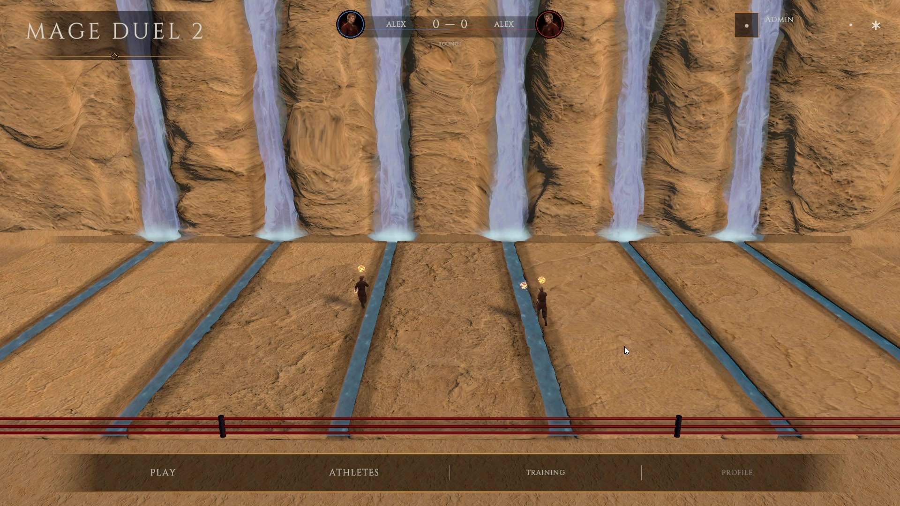
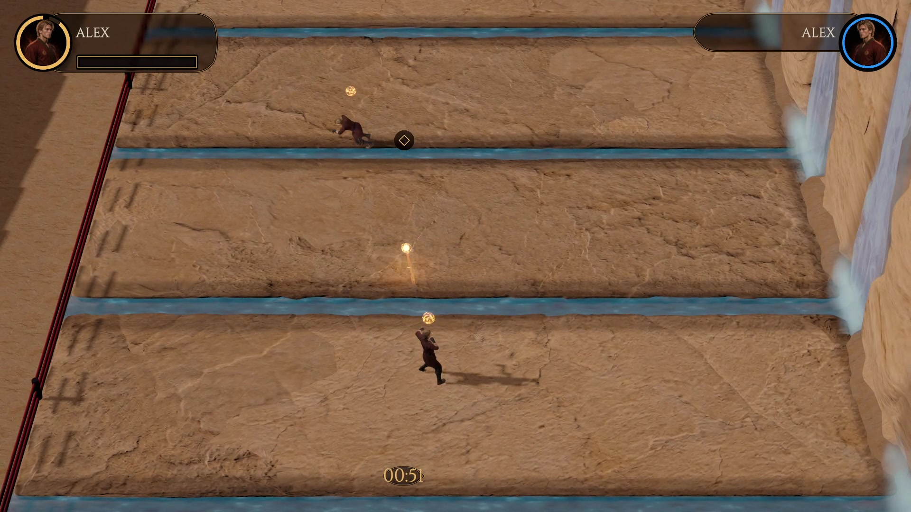
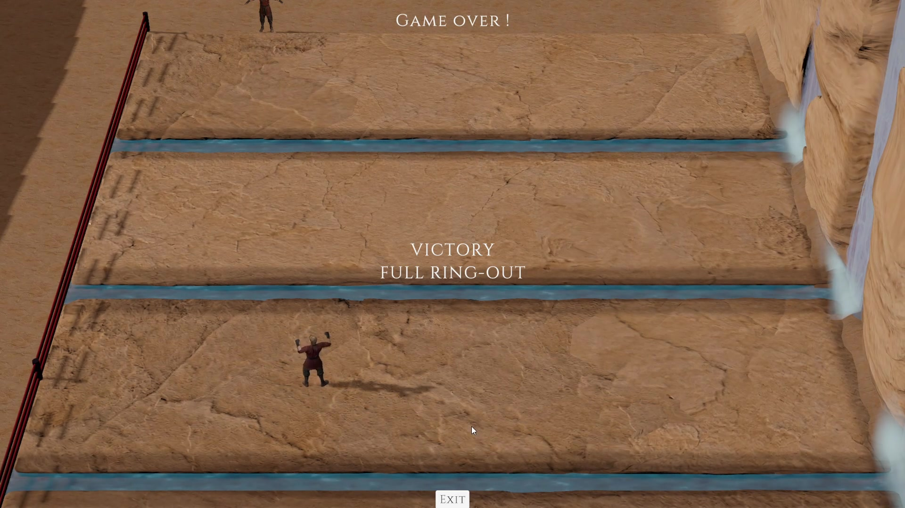
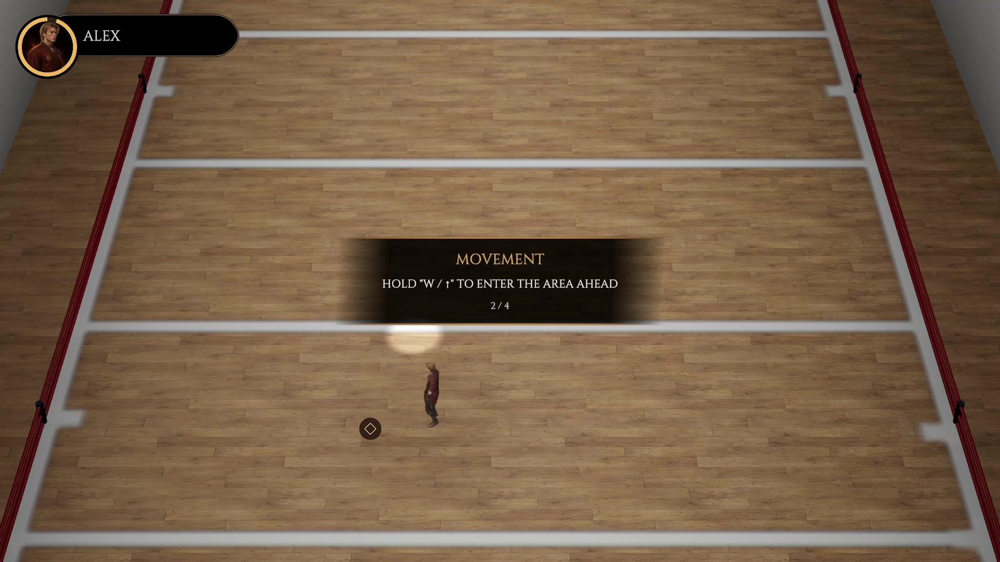
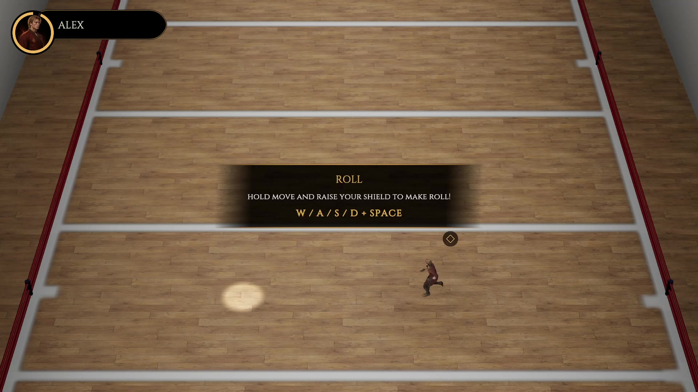
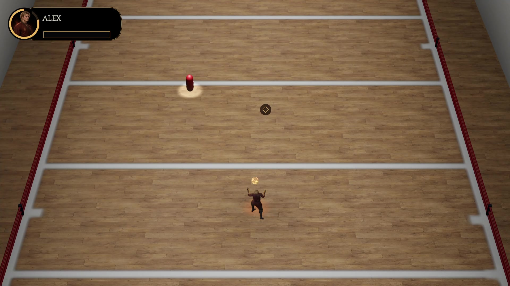

# Mage Duel 2

**Mage Duel 2** is a server-authoritative competitive arena prototype in which magical athletes fight for territory rather than health points.

Players cast limited projectiles, charge attacks, block, roll and force an opponent away from the centre of a seven-zone arena. A hit changes the territorial front instead of ending the round. Losing the third zone causes an immediate full ring-out, preserving a difficult comeback route even when the round score is 0:2.

[Watch the 89-second gameplay preview](Media/Video/MageDuel2-Gameplay-Preview.mp4)

> The current capture has no production audio. Sound design is in development.



## Why this project exists

The original prototype ended ordinary rounds on the first hit. That rule was readable, but it made most of the arena irrelevant and stopped the action at its most interesting moment. The territorial redesign turns every hit into a persistent spatial consequence:

```text
projectile hit
    -> knockback
    -> territory changes
    -> future risk increases
    -> referee assigns new positions
    -> the same round continues
```

This keeps the arena itself legible as the primary state of the match without adding a health bar.

## Project context

- **Development:** approximately three months as of October 2026.
- **Team:** solo project.
- **Role:** Solo Creator & Game Designer, including creative direction, systems design, UI/UX, art direction, Unity integration, tuning, playtesting and project QA.
- **Technology:** Unity 6 / URP / uGUI, ASP.NET Core / .NET 9, WebSockets, EF Core and standalone .NET bot clients.
- **Current state:** advanced playable online prototype / vertical slice in development.

Development is AI-assisted. The creator authored the design rules, requirements and acceptance criteria, directed implementation, integrated and tested the results, tuned the game and made the final decisions. AI tools produced a substantial part of the programming work under that direction.

## Current playable systems

- server-authoritative 1v1 territorial matches;
- seven ordered arena zones and a moving territorial front;
- round scoring by distance from centre;
- immediate match victory through full ring-out;
- referee-controlled positioning windows, spotlights, yellow cards and disqualification;
- cast, segmented attack, directional block, roll, energy and ricochet mechanics;
- random and password matchmaking;
- reconnect window with temporary server-side defence;
- three bot behaviour profiles;
- a dedicated Fight the Teacher match;
- guided lessons for movement, block, roll, cast and attack;
- live match broadcasting inside the main menu.

## Gameplay images

### Territorial combat



### Full ring-out



### Guided movement lesson



### Guided roll lesson



### Guided casting lesson



## Five-minute reviewer path

1. Read the [Territorial Combat Design Case Study](Documents/Current/DesignCaseStudy.md) for the original problem, rejected alternatives and current solution.
2. Read the [Game Design Document](Documents/Current/GameDesignDocument.md) for the complete player experience.
3. Use the [Territorial Combat Rules](Documents/Current/TerritorialCombatRules.md) for normative match behaviour.
4. Check [Project Status](Documents/Current/ProjectStatus.md) for verified implementation and honest limitations.
5. Browse [selected source samples](SourceSamples/README.md) to see how the design was translated into server and Unity code.

Additional current documentation:

- [Tutorial Design](Documents/Current/TutorialDesign.md)
- [Balance and Tuning](Documents/Current/BalanceAndTuning.md)
- [Technical Overview](Documents/Current/TechnicalOverview.md)
- [Network Protocol](Documents/Current/NetworkProtocol.md)
- [Unity Asset Structure](Documents/Current/UnityAssetStructure.md)

## Validation so far

- Roughly 100-150 creator-played matches against each bot profile.
- Approximately ten creator completions of the guided lessons.
- Informal feedback collected on combat readability, interface and presentation.
- One observed first-time player attempt in which the teacher bot won in roughly 20 seconds, identifying onboarding difficulty as a real tuning risk.

These are qualitative development observations, not a controlled usability study. The next validation pass will record match duration, territory reversals, full ring-out frequency, tutorial retries and first-time player survival.

## Repository scope

This is a portfolio-safe presentation repository, not the complete production workspace. It contains current design documentation, original screenshots, a compressed gameplay preview and selected code samples. Raw third-party assets, Mixamo animation files, generated local configuration and the complete Unity project are intentionally excluded.

The source samples are provided for review and are not a standalone build. See [SourceSamples/README.md](SourceSamples/README.md) for context.

## Current limitations

- production audio is not implemented;
- guided lessons still require final acceptance and broader new-player testing;
- the battle HUD and training environment remain under visual review;
- deployment, production email delivery and operational infrastructure are outside the present milestone;
- this repository does not contain a downloadable game build.

The project demonstrates the core design proposition and the relationship between rules, authoritative simulation, bots, camera, tutorial and UI. It is not presented as a shipped online service.

